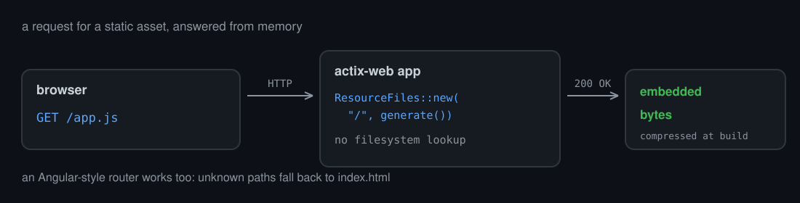

<h1>actix-web-static-files</h1>

The actix-web side of <a href="/static-files/">static-files</a>.

  Once the frontend is inside the binary, something has to answer requests for it.
  This is that something: one service that serves the bundled resources, with the
  content type and cache behaviour a browser expects.

<h2>What changes for you</h2>

<ul>
  <li><strong>One line in your app.</strong>
    <code>ResourceFiles::new("/", generate())</code> and the whole site is served.</li>
  <li><strong>Answers come from memory.</strong> No <code>open()</code>, no path
    traversal question, no missing-file case to handle.</li>
  <li><strong>Single-page apps work.</strong> A path that is not a file falls back to
    <code>index.html</code>, so an Angular-style router deep link opens instead of
    404ing.</li>
  <li><strong>The rest of actix-web is untouched.</strong> Your API routes keep their
    own scope; the static service only takes what is left.</li>
  <li><strong>Custom npm toolchains.</strong> The underlying crate drives npm, yarn
    or pnpm, so the frontend build is part of <code>cargo build</code>.</li>
</ul>

<h2>Getting it</h2>

<figure class="code" data-file="Cargo.toml"><pre><code class="language-toml">[dependencies]
actix-web-static-files = { version = "4.1", features = ["static-files-03"] }
static-files = "0.3"</code></pre></figure>

<figure class="code" data-file="build.rs"><pre><code class="language-rust">use static_files::resource_dir;

fn main() -&gt; std::io::Result&lt;()&gt; {
    resource_dir("./static").build()
}</code></pre></figure>

<figure class="code" data-file="src/main.rs"><pre><code class="language-rust">use actix_web::{App, HttpServer};
use actix_web_static_files::ResourceFiles;

include!(concat!(env!("OUT_DIR"), "/generated.rs"));

#[actix_web::main]
async fn main() -&gt; std::io::Result&lt;()&gt; {
    HttpServer::new(|| {
        let generated = generate();
        App::new().service(ResourceFiles::new("/", generated))
    })
    .bind("127.0.0.1:8081")?
    .run()
    .await
}</code></pre></figure>

  There are
  <a href="https://github.com/kilork/actix-web-static-files-examples">examples</a>
  for a plain folder, a webpack build and an Angular router, and a
  <a href="https://github.com/kilork/actix-web-static-files-bench">benchmark</a> for
  the serving overhead.

<h2>Where to look</h2>

  <a href="https://github.com/kilork/actix-web-static-files">source</a> &middot;
  <a href="https://crates.io/crates/actix-web-static-files">crate</a> &middot;
  <a href="https://docs.rs/actix-web-static-files">docs</a>

<a href="/projects/">All projects</a>

