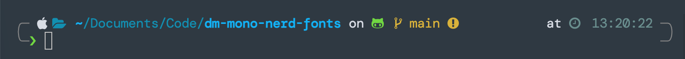

<h1>dm-mono-nerd-font</h1>

DM Mono patched with Nerd Fonts, plus Cyrillic and box drawing.

Click the sample for the full-size version.

  DM Mono is a lovely coding face until your prompt wants a branch icon, your file
  manager wants a folder glyph, and your language wants Cyrillic. Then you get boxes.
  This is the same font with those glyphs added — and, unlike most patched fonts,
  everything stays at the same width, so nothing jitters.

<h2>What changes for you</h2>

<ul>
  <li><strong>Icons that line up.</strong> Nerd Fonts' powerline, devicons and
    Font Awesome ranges, patched in rather than bolted on.</li>
  <li><strong>Cyrillic that is actually drawn.</strong> The full Russian alphabet and
    the Cyrillic Supplement, at monospace width.</li>
  <li><strong>Terminal furniture.</strong> Arrows, all box-drawing characters and
    block elements, so progress bars and TUI frames render properly.</li>
  <li><strong>Works with powerlevel10k</strong> — the BlexMono glyphs it expects are
    included.</li>
  <li><strong>Easy to keep current</strong>: Homebrew cask on macOS, an install
    script on Linux, archives on the releases page.</li>
</ul>

<h2>Getting it</h2>

<figure class="code"><pre><code class="language-bash"># macOS
brew install --cask kilork/dm-mono-nerd-font/dm-mono-nerd-font

# Linux
curl -fsSL https://raw.githubusercontent.com/kilork/dm-mono-nerd-font/main/install.sh | bash</code></pre></figure>

  Then pick "DM Mono Nerd Font" in your terminal and editor. The
  <a href="https://github.com/kilork/dm-mono-nerd-font/releases">releases</a> have the
  plain archives if you would rather copy fonts around yourself.

<h2>Where to look</h2>

  <a href="https://github.com/kilork/dm-mono-nerd-font">source</a> &middot;
  <a href="https://github.com/kilork/homebrew-dm-mono-nerd-font">homebrew tap</a>

<a href="/projects/">All projects</a>

