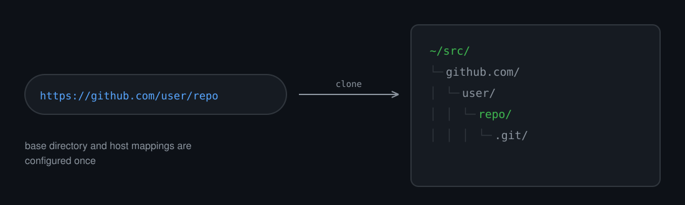

<h1>git-site-clone</h1>

Clone any repository into your own tidy source tree.

  If you keep code in <code>~/src/host/owner/repo</code>, cloning by hand is a small
  ritual every time: mkdir the directories, clone, hope you spelled the owner right.
  This does it in one command.

<h2>What changes for you</h2>

<ul>
  <li><strong>One command per repository.</strong>
    <code>git-site-clone https://github.com/user/repo</code> ends up in
    <code>&lt;base&gt;/github.com/user/repo</code>.</li>
  <li><strong>Configure it once.</strong> A base directory and per-host mappings, so
    GitHub can live on one disk and your company's GitLab on another.</li>
  <li><strong>The clipboard counts as input.</strong> Copy a URL, run
    <code>git-site-clone</code>, done.</li>
  <li><strong>It tells you where it went</strong> (and can stay put instead of
    changing directory, for scripts).</li>
</ul>

<h2>Getting it</h2>

<pre><code class="language-bash">cargo install git-site-clone</code></pre>

<pre><code class="language-bash">git-site-clone config base ~/src
git-site-clone https://github.com/user/repo.git      # -&gt; ~/src/github.com/user/repo
git-site-clone config mappings add github.com /Volumes/work/github.com
git-site-clone config show</code></pre>

<h2>Where to look</h2>

  <a href="https://github.com/rust-application/git-site-clone">source</a> &middot;
  <a href="https://crates.io/crates/git-site-clone">crate</a>

<a href="/projects/">All projects</a>

