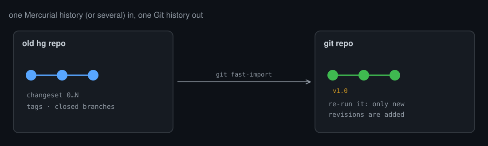

<h1>hg-git-fast-import</h1>

Mercurial to Git, history and awkward parts included.

  Merging, tags, closed branches, a decade of revisions — moving off Mercurial is
  usually where history quietly gets lost. This converter feeds the repository
  through <code>git fast-import</code> and keeps what was there.

<h2>What changes for you</h2>

<ul>
  <li><strong>One repository, or many into one.</strong> Migrating a project is
    <code>single</code>; folding a bunch of small Mercurial repositories into one Git
    repository is <code>multi</code>.</li>
  <li><strong>Re-runnable.</strong> Import new revisions later without starting over —
    it keeps its marks and adds only what is new (handy for a <code>--cron</code>
    pass while both are alive).</li>
  <li><strong>Tags and closed branches survive</strong>, so releases and old
    maintenance lines still make sense in Git.</li>
  <li><strong>You can check the result.</strong> The tool verifies the imported
    repository against the source with a diff, instead of asking you to trust it.</li>
  <li><strong>Any way you install it.</strong> crates.io, release binaries or Snap.</li>
</ul>

<h2>Getting it</h2>

<pre><code>cargo install hg-git-fast-import</code></pre>

<pre><code>hg-git-fast-import single ~/work/old-project ~/src/github.com/me/old-project
hg-git-fast-import multi --help       # several hg repos into one git repo
hg-git-fast-import build-marks        # rebuild the saved state if needed</code></pre>

<h2>Where to look</h2>

  <a href="https://github.com/kilork/hg-git-fast-import">source</a> &middot;
  <a href="https://crates.io/crates/hg-git-fast-import">crate</a>

<a href="/projects/">All projects</a>

