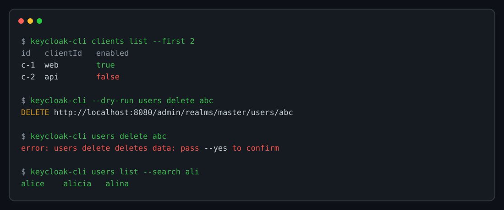

<h1>keycloak-cli</h1>

Every admin operation as a command, generated from the crate.

  Keycloak's admin API has 415 operations. <code>kcadm.sh</code> covers the
  useful-looking ones; for everything else you end up writing curl with a token you
  fetched by hand, and typing the same realm and URL shape again next week.

  This is the whole thing as commands, named after the API path and verb, so
  <code>clients list</code>, <code>users role-mappings realm get</code> and
  <code>organizations invitations resend</code> all just exist.

<h2>What changes for you</h2>

<ul>
  <li><strong>You log in once per terminal.</strong> <code>keycloak-cli login</code>
    keeps the token for that shell; scripts and completions reuse it. Another
    terminal asks for a password until it logs in — that is the point.</li>
  <li><strong>TAB knows your data.</strong> After logging in, <code>--realm</code>
    completes realm names and user, group and client arguments complete from the
    API. Values are cached for a minute, so the next TAB is instant.</li>
  <li><strong>The output fits the caller.</strong> Table in a terminal, JSON when
    piped, or YAML, markdown and HTML on request; <code>--fields</code> picks the
    columns.</li>
  <li><strong>You can look before you leap.</strong> <code>--dry-run</code> prints
    the request (method, URL with its query, and the body), and every
    <code>delete</code> needs <code>--yes</code>.</li>
  <li><strong>There is a report, too.</strong> <code>keycloak-cli report</code> writes
    a markdown or self-contained HTML page with charts of users, events and
    sessions, for the times a table is not the answer.</li>
</ul>

<h2>Getting it</h2>

<pre><code>curl -fsSL https://raw.githubusercontent.com/rust-utility/keycloak-cli/main/install.sh | sh
keycloak-cli self-update --check</code></pre>

  The installer downloads the binary for your platform (macOS arm64/x86_64, static
  musl Linux aarch64/x86_64), checks it against the release's
  <code>SHA256SUMS</code> and installs it. <code>keycloak-cli self-update</code>
  does the same from the CLI. <code>cargo install keycloak-cli</code> works as well.

<h2>A five-line script</h2>

<pre><code>keycloak-cli login
for c in $(keycloak-cli clients list --fields clientId | tail -n +2); do
  keycloak-cli clients get "$c"
done
keycloak-cli logout</code></pre>

<h2>Where to look</h2>

  <a href="https://github.com/rust-utility/keycloak-cli">source</a> &middot;
  <a href="https://crates.io/crates/keycloak-cli">crate</a> &middot;
  <a href="https://docs.rs/keycloak-cli">docs</a> &middot;
  <a href="https://github.com/rust-utility/keycloak-cli/blob/main/doc/ROADMAP.md">roadmap</a>

<a href="/projects/">All projects</a>

