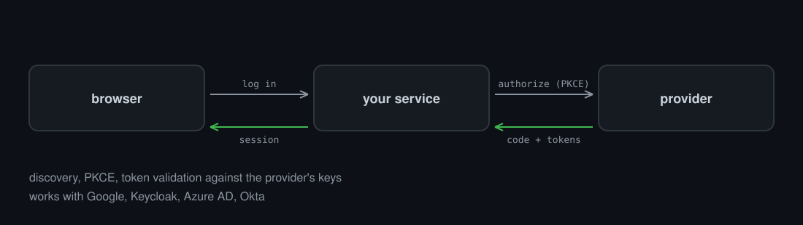

<h1>openid</h1>

OpenID Connect and Discovery for Rust services.

  If you need "log in with Google/Keycloak/Azure/Okta" in a Rust service, this gives
  you the protocol and nothing else. You keep your web framework; you call the
  library from the handlers you already have.

<h2>What changes for you</h2>

<ul>
  <li><strong>Discovery instead of configuration.</strong> Point it at the issuer and
    the endpoints, keys and supported flows come from
    <code>/.well-known/openid-configuration</code>.</li>
  <li><strong>PKCE on by default.</strong> The authorization-code flow is the safe
    one, and the library does not make you opt into it.</li>
  <li><strong>Real token validation.</strong> ID tokens are validated against the
    provider's keys; userinfo is a call away.</li>
  <li><strong>The awkward providers included.</strong> Azure/Microsoft needs issuer
    exceptions and has a feature for exactly that. UMA2 and token introspection are
    there too.</li>
  <li><strong>Async, on reqwest.</strong> Works with the runtime and HTTP client you
    already use.</li>
</ul>

<h2>Getting it</h2>

<figure class="code"><pre><code class="language-bash">cargo add openid</code></pre></figure>

Roughly the shape of it:

<figure class="code"><pre><code class="language-rust">let client = DiscoveredClient::discover(client_id, client_secret, None, issuer).await?;
let (auth_url, _csrf) = client.auth_url(Default::default());
// ...the provider redirects back with a code...
let token = client.request_token(&amp;code).await?;
let claims = client.id_token_claims(&amp;token.id_token)?;</code></pre></figure>

<h2>Where to look</h2>

  <a href="https://github.com/kilork/openid">source</a> &middot;
  <a href="https://crates.io/crates/openid">crate</a> &middot;
  <a href="https://docs.rs/openid">docs</a> &middot;
  <a href="https://github.com/kilork/openid-examples">examples</a>

<a href="/projects/">All projects</a>

