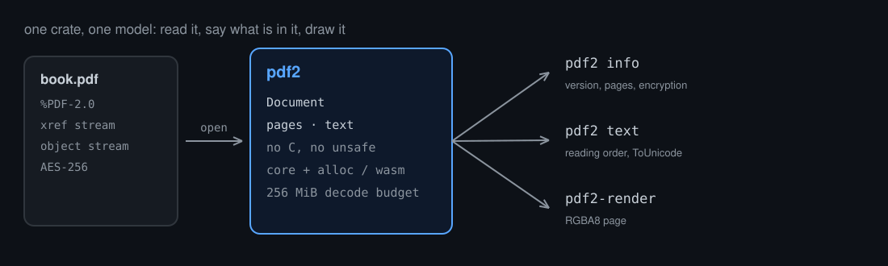

<h1>pdf2</h1>

A reader, writer and text extractor for PDF 1.x and PDF 2.0.

  Every mature PDF implementation is a C library behind a wrapper: pdfium,
  poppler, MuPDF. That is the right answer until the place you need it has no C —
  a wasm module, a microcontroller, a sandbox where a parser bug is a security
  incident. This implements the format itself: four dependencies, only for DEFLATE
  and AES/SHA.

<h2>What changes for you</h2>

<ul>
  <li><strong>You can see what a file contains.</strong>
    <code>pdf2 info</code> reports version, page count, encryption and metadata;
    <code>pdf2 check</code> opens, decodes and extracts every page and tells you
    what fails instead of handing you a garbled string.</li>
  <li><strong>Text that comes out in reading order.</strong> Simple fonts through
    their encodings, composite fonts through their <code>/ToUnicode</code> maps,
    including the code-space splitting those need.</li>
  <li><strong>Nothing panics on hostile input.</strong> Every malformed file is an
    <code>Err</code>; the robustness tests truncate and mutate fixtures and run the
    whole read API on whatever still opens.</li>
  <li><strong>No decompression bombs.</strong> A stream decodes under a 256 MiB
    budget you can change, and an image is measured from its own declared geometry
    before a byte of it is allocated.</li>
  <li><strong>Runs where C cannot.</strong> <code>no_std</code> with
    <code>core</code> + <code>alloc</code> (CI builds a <code>thumbv7em</code>
    target), wasm for the browser and WASI, with size budgets in CI.</li>
  <li><strong>It writes, too.</strong> <code>Document::new()</code> plus
    <code>save()</code> produce a real PDF 2.0 file: object streams, a compressed
    cross-reference stream, XMP metadata — and the crate reads its own output back
    and compares the whole object graph.</li>
  <li><strong>Encrypted files open.</strong> AES-256 (<code>/V 5 /R 6</code>) and
    the legacy revisions, with user and owner passwords.</li>
</ul>

<h2>Getting it</h2>

<figure class="code"><pre><code class="language-bash">cargo install pdf2-cli

pdf2 info report.pdf         # version, pages, encryption, metadata
pdf2 pages report.pdf        # object id, boxes, rotation per page
pdf2 text report.pdf --all   # extracted text
pdf2 check report.pdf        # decode and extract everything</code></pre></figure>

As a library:

<figure class="code"><pre><code class="language-rust">use pdf2::Document;

let document = Document::open(std::fs::read("report.pdf")?)?;
println!("PDF {}", document.version());

for page in document.pages()? {
    println!("{:?}, rotate {}", page.media_box, page.rotate);
}</code></pre></figure>

  Drawing is the sibling crate <code>pdf2-render</code>: paths, fills, strokes,
  clips, transforms, text and images into RGBA8, proven page by page against
  arithmetic in <code>tests/fixtures/calibration.pdf</code> rather than against the
  last render. There is a
  <a href="https://pdf2-rs.github.io/pdf2/">wasm demo</a> if you would rather poke
  at it than read about it.

  Where another implementation is simply better — the strongest renderer
  (<code>hayro</code>, <code>pdfium</code>) or editing existing files
  (<code>lopdf</code>) — the README says so in a comparison table with the column
  where this crate loses. That honesty is part of the design: the goal is one model
  that reads, inspects, draws and writes, not a claim to beat Chromium's engine.

<h2>Where to look</h2>

  <a href="https://github.com/pdf2-rs/pdf2">source</a> &middot;
  <a href="https://crates.io/crates/pdf2">crate</a> &middot;
  <a href="https://docs.rs/pdf2">docs</a> &middot;
  <a href="https://pdf2-rs.github.io/pdf2/">wasm demo</a>

<a href="/projects/">All projects</a>

