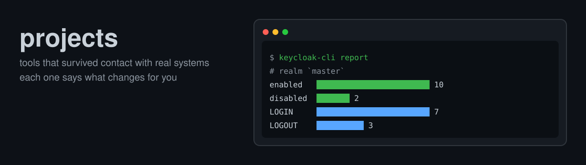

<h1>Projects</h1>

  Things I built because the existing tool either did not exist or did not survive
  contact with a real system. Each one says what changes for you if you use it,
  not what it contains. If a page is linked, it has a longer note.



  <h2>{{ group.name }}</h2>
  
  <section class="project">
    <h3>
      <a href="{{ project.page | relative_url }}">{{ project.name }}</a>
      <a href="{{ project.repo }}">{{ project.name }}</a>
    </h3>
    
{{ project.tagline }}

    
{{ project.benefit }}

    
For {{ project.audience }}

    

      <a href="{{ project.repo }}">source</a>
      &middot; <a href="{{ project.crate }}">crate</a>
      &middot; <a href="{{ project.page | relative_url }}">notes</a>
    

    
    <pre><code>{{ project.install }}</code></pre>
    
  </section>
  

