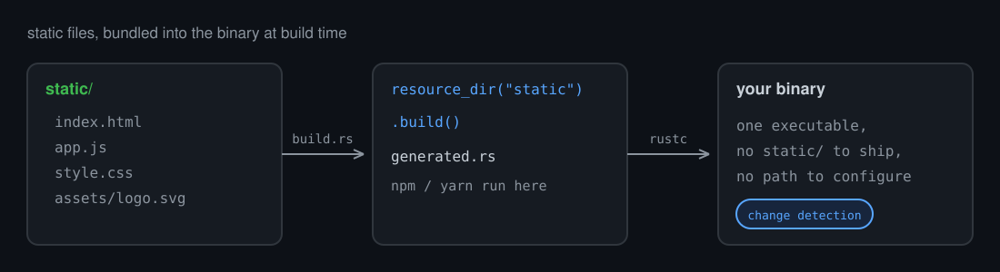

<h1>static-files</h1>

Static resources, collected at build time and compiled in.

  Shipping a Rust server with a frontend usually means shipping two things: the
  binary and a directory of files it must find at runtime. This removes the second
  one. The files are read at build time, turned into Rust data and compiled in.

<h2>What changes for you</h2>

<ul>
  <li><strong>One artefact to deploy.</strong> No assets volume, no
    <code>--static-dir</code> flag, no "works locally, 404s in production".</li>
  <li><strong>No filesystem call per request.</strong> The bytes are already in the
    process, which is also why a cold container has no warm-up for them.</li>
  <li><strong>Your frontend build runs in the same step.</strong>
    <code>NpmBuild</code> installs dependencies, runs <code>npm run build</code> (or
    yarn/pnpm) and bundles the result — <code>cargo build</code> is the whole
    pipeline.</li>
  <li><strong>Fast rebuilds.</strong> Change detection is on by default, so touching
    a file re-bundles, and touching nothing does not.</li>
  <li><strong>Deterministic output.</strong> Resource order is sorted by default,
    with filters and module splitting when a bundle gets big.</li>
</ul>

<h2>Getting it</h2>

<pre><code>cargo add static-files --build
cargo add static-files</code></pre>

Minimal case — a folder of files:

<pre><code>// build.rs
use static_files::resource_dir;

fn main() -&gt; std::io::Result&lt;()&gt; {
    resource_dir("./static").build()
}</code></pre>

<pre><code>// src/main.rs
include!(concat!(env!("OUT_DIR"), "/generated.rs"));

let resources = generate();   // index.html, app.js, … as bytes</code></pre>

With a frontend that needs building first:

<pre><code>// build.rs
use static_files::NpmBuild;

fn main() -&gt; std::io::Result&lt;()&gt; {
    NpmBuild::new("web")
        .install()?
        .run("build")?
        .target("web/dist")
        .to_resource_dir()
        .build()
}</code></pre>

  <code>NpmBuild</code> skips the install and the build when nothing changed, so this
  is cheap on a warm tree.

<h2>Where to look</h2>

  <a href="https://github.com/static-files-rs/static-files">source</a> &middot;
  <a href="https://crates.io/crates/static-files">crate</a> &middot;
  <a href="https://docs.rs/static-files">docs</a>

<a href="/projects/">All projects</a>

