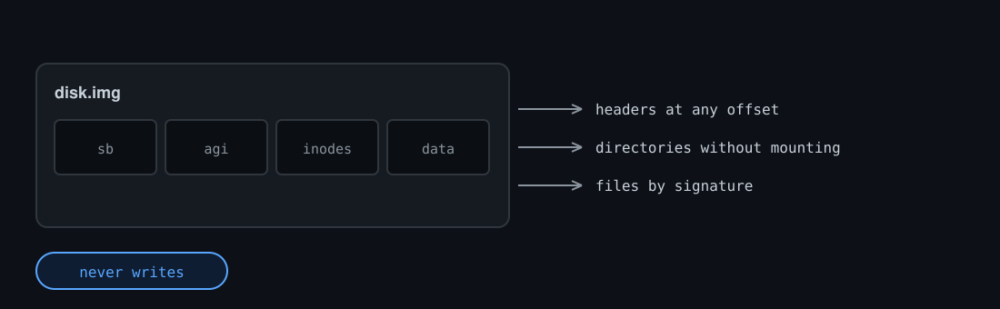

<h1>xfs-doctor</h1>

Read-only rescue tools for damaged XFS filesystems and disk images.

  The usual story: a NAS dropped a disk, the filesystem will not mount, and every
  tool that could help wants to mount it first. <code>xfs-doctor</code> reads the
  image as bytes — no mount, no <code>xfs_db</code>, nothing written.

<h2>What changes for you</h2>

<ul>
  <li><strong>You do not need the array working.</strong> Headers are found at any
    offset, and a RAID0 half-image's geometry can be worked out from one member.</li>
  <li><strong>You can inspect before you commit.</strong> Superblocks and AGIs are
    decoded and printed, so you know what you are looking at before salvaging.</li>
  <li><strong>Directory structure survives.</strong> Inodes and directories are
    salvaged by scanning rather than by asking the filesystem to mount.</li>
  <li><strong>Content survives metadata damage.</strong> When the structure is gone,
    files are carved by signature: JPEG, PNG, PDF, ZIP, RIFF, MP4, gzip, tar.</li>
  <li><strong>The original never changes.</strong> Every command is read-only, which
    is what makes it usable before a repair or as a forensic pass.</li>
</ul>

<h2>Getting it</h2>

<pre><code>cargo install xfs-doctor</code></pre>

A damaged image is usually explored in this order:

<pre><code>xfs-doctor read --device disk.img sb                     # find the superblock
xfs-doctor read --device disk.img --offset 0x100000 sb   # ...or at an offset
xfs-doctor salvage --device disk.img --sb sb.bin \
  --chunk 512K --data-offset 8K --member 1 --out salvage/ --scan 256M
xfs-doctor carve --device disk.img --out carve/ --types jpeg,png,mp4 --max 16M</code></pre>

  Half of a RAID0 that lost its partner is a geometry problem;
  <code>xfs-doctor map</code> is for that.

<h2>Where to look</h2>

  <a href="https://github.com/rust-utility/xfs-doctor">source</a> &middot;
  <a href="https://crates.io/crates/xfs-doctor">crate</a>

<a href="/projects/">All projects</a>

